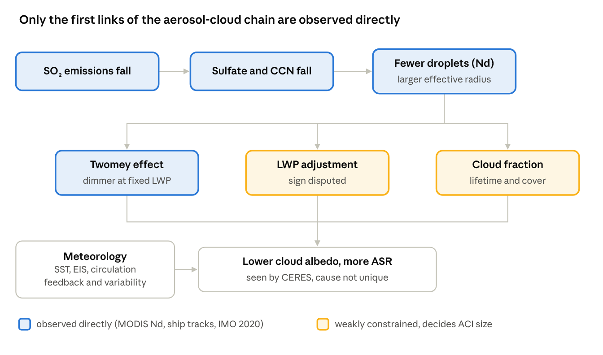

# Declining Planetary Albedo and the Recent Warming Acceleration: Separating Aerosol, Cloud and Aerosol–Cloud Interaction Contributions — A Literature Review

Oct 26, 2026 · Live version: https://claude.ai/artifact/AjVFJ3p3SyWifTf64VFHnf

## 1. Introduction

The literature now agrees that Earth's recent acceleration of warming is carried mostly by more absorbed sunlight, and that a reduction in low-cloud reflection is the largest single term — but it does not yet agree on why the clouds changed. Earth's energy imbalance (EEI) roughly doubled from ~0.5 to ~1.0 W m⁻² between the 2000s and the 2010s–2020s, peaked near 1.8 W m⁻² in 2023, and most of the increase is in absorbed shortwave radiation (ASR), not reduced outgoing longwave radiation.

The 2023–24 temperature spike sharpened the question. Goessling et al. (2025) showed that 2023 had a record-low planetary albedo, driven mainly by reduced low cloud over the northern mid-latitudes and tropics, which closes an otherwise unexplained ~0.2 K gap. They explicitly left open how much of the low-cloud loss is internal variability, reduced aerosol, or an emerging low-cloud feedback.

This review asks one question: can the contributions of (i) aerosol–radiation interactions (ARI), (ii) aerosol–cloud interactions (ACI) and (iii) cloud changes driven by warming, circulation or variability be separated with current evidence — or can any one of them be shown to dominate? It covers work through October 2026, with emphasis on observational evidence for the aerosol → cloud → albedo chain.

## 2. Observational basis: a growing imbalance carried by sunlight

CERES and ocean heat content records agree that the EEI trend is about 0.45–0.5 W m⁻² per decade since the early 2000s, and models struggle to reproduce it.

| Study | Data / period | Key result |
| --- | --- | --- |
| [Loeb et al. 2021, GRL](https://doi.org/10.1029/2021GL093047) | CERES + Argo, 2005–2019 | EEI roughly doubled; ASR increase from reduced cloud and sea-ice reflection |
| [Loeb et al. 2024, Surv. Geophys.](https://doi.org/10.1007/s10712-024-09838-8) | CERES, 2000–2022 | EEI ~0.5 → ~1.0 W m⁻²; ASR +0.9 offset by OLR +0.4 W m⁻² |
| [Hodnebrog et al. 2024, CEE](https://doi.org/10.1038/s43247-024-01324-8) | CERES, 2001–2019 | EEI trend 0.47 ± 0.17 W m⁻² dec⁻¹; models low by 10–40% |
| [Goessling et al. 2025, Science](https://doi.org/10.1126/science.adq7280) | CERES + ERA5, to 2023 | Record-low albedo in 2023 from low-cloud loss; ~0.2 K of the 2023 anomaly |
| [Mauritsen et al. 2025, AGU Adv.](https://doi.org/10.1029/2024AV001636) | Multi-source, to 2023 | EEI ~1.8 W m⁻² in 2023, about twice the IPCC AR6 estimate; observing system at risk |
| [Myhre et al. 2025, Science](https://doi.org/10.1126/science.adt0647) | CERES vs CMIP6, 2001–2023 | Models with ECS < 2.5 K cannot reproduce observed TOA trends |

Two points matter for attribution. First, the shortwave trend is concentrated over Northern Hemisphere oceans (North Pacific, North Atlantic), where aerosol emissions fell most — but where SST also warmed fastest, so the spatial fingerprint alone cannot separate cause from response. Second, the model–observation gap is itself evidence: either models under-represent aerosol forcing trends, or they under-represent cloud feedback, or the trend is partly internal variability. Each of the studies in Section 3 essentially picks one of these explanations.

## 3. Attribution: cloud feedback vs aerosol vs circulation

Estimates of the aerosol share of the shortwave EEI trend now span from ~0 to ~50%, and the spread is driven by method more than by data. Studies that let clouds respond to an observed droplet-number decline (Yuan 2026, Zelinka 2026, von Salzen 2025) find a large ACI term; studies that regress against aerosol optical depth or reanalysis sulfate globally (Park & Soden 2025) find almost none.

| Study | Method | Aerosol (ARI + ACI) contribution | Cloud / other contribution |
| --- | --- | --- | --- |
| [Quaas et al. 2022, ACP](https://doi.org/10.5194/acp-22-12221-2022) | Emissions, AOD, Nd, CERES, models | Aerosol ERF trend reversed sign after ~2000, now a warming trend | — |
| [Hodnebrog et al. 2024, CEE](https://doi.org/10.1038/s43247-024-01324-8) | Fixed-SST multi-model ERF | +0.2 ± 0.1 W m⁻² dec⁻¹ (~40% of trend) | Remainder: GHG, feedbacks |
| [Park & Soden 2025, Sci. Adv.](https://doi.org/10.1126/sciadv.adv9429) | Regression on MODIS AOD and reanalysis sulfate | ≈0 globally: NH clean-up offset by SH wildfire and Hunga Tonga aerosol | Clouds and natural variability |
| [Tselioudis et al. 2025, GRL](https://doi.org/10.1029/2025GL114882) | Cloud-regime / circulation decomposition | Not isolated | 0.37 of 0.45 W m⁻² dec⁻¹ from contraction of storm-track and ITCZ cloud zones |
| [Ceppi et al. 2026, ACP](https://doi.org/10.5194/acp-26-4153-2026) | CERES cloud-controlling-factor (CCF) regression, 2003–2024 | Sulfate adjustment of low cloud ~0.05 W m⁻² dec⁻¹ | Low-cloud total 0.22; feedback ~0.09; GHG adjustment ~0.03 |
| [Yuan et al. 2026, Nat. Commun.](https://doi.org/10.1038/s41467-026-72926-3) | MODIS Nd trend × observed cloud adjustment functions, 2003–2023 | ERF_ACI +0.33 W m⁻² dec⁻¹ (60°S–60°N oceans; EEI trend there 0.63); +0.21–0.25 global | Implies weak SW cloud feedback |
| [Zelinka et al. 2026, CEE](https://doi.org/10.1038/s43247-026-03461-8) | CCF with aerosol term, 2003–2024 | North Atlantic: ~0.4 W m⁻² dec⁻¹ cloud trend almost entirely from sulfate decline; North Pacific: ~0.3 from aerosol | North Pacific SST ~0.3; ECS ~3 °C (2.7–4.1), no sign of an emerging strong feedback |
| [Li et al. 2026, ACP](https://doi.org/10.5194/acp-26-12591-2026) | CERES cloud-type decomposition, 2002–2023 | Lower AOD one of the CF drivers at 30–60°N | Cloud-reflected SW −0.22 W m⁻² dec⁻¹, mostly lower reflectivity, not cloud fraction |

Three readings of this table hold up:

- **Clouds dominate the shortwave trend.** Every decomposition puts reduced low-cloud reflection at roughly 50–80% of the ASR increase.
- **The ACI share is regional before it is global.** Over the North Atlantic and North Pacific, two independent 2025–26 studies (von Salzen; Zelinka) attribute most of the cloud-reflection loss to aerosol decline. The global figure depends on how Southern Hemisphere aerosol increases and land areas are treated.
- **ACI and cloud feedback trade off.** Yuan et al. note that a large ERF_ACI implies a weak shortwave cloud feedback, and Zelinka et al. reach a similar conclusion through ECS. So "is it aerosol or feedback?" is one constrained question, not two independent ones.

Yuan et al. (2026) also tabulate the model and regression estimates side by side: RFMIP models give 0.06–0.15 W m⁻² dec⁻¹ globally, Park & Soden's own regression gives −0.005, and the observation-based cloud-adjustment method gives 0.21–0.33.

## 4. The aerosol → cloud → albedo chain and its observational evidence

The first links of the chain (fewer aerosols, then fewer cloud droplets) are now observed directly; the link that matters most for albedo (liquid water path and cloud-fraction adjustments) is still inferred rather than observed.

**Mechanism.** Lower SO₂ emissions reduce sulfate aerosol and cloud condensation nuclei (CCN). With fewer CCN, a liquid cloud forms fewer, larger droplets: droplet number (Nd) falls and effective radius (re) rises. At fixed liquid water path (LWP), this lowers cloud albedo — the Twomey effect. The cloud then adjusts. Fewer, larger droplets can rain out more easily and lose water and lifetime (an Albrecht-type lowering of LWP and cloud fraction, CF). They can also entrain less dry air and keep more water, which opposes the Twomey effect. The sign and size of these adjustments set whether ACI is a small or a large part of the albedo trend.

Meteorology acts on the same clouds in parallel, which is why the aerosol and feedback terms are hard to separate.

### 4a. Shipping: IMO 2020 as a natural experiment

The 2020 cap on fuel sulfur cut open-ocean shipping SO₂ by ~80% almost overnight, without changing meteorology — the cleanest test of the chain.

| Study | Type | Result |
| --- | --- | --- |
| [Yuan et al. 2022, Sci. Adv.](https://doi.org/10.1126/sciadv.abn7988) | Observation | Global ship-track occurrence dropped sharply after the regulation |
| [Manshausen et al. 2022, Nature](https://doi.org/10.1038/s41586-022-05122-0) | Observation | "Invisible" ship tracks show a larger cloud sensitivity to aerosol than visible tracks, so visible-track studies are biased |
| [Diamond 2023, ACP](https://doi.org/10.5194/acp-23-8259-2023) | Observation, SE Atlantic shipping corridor | Smaller re reduction and less cloud brightening after 2020; local instantaneous forcing O(1 W m⁻²) |
| [Diamond & Boss 2025, ACP](https://doi.org/10.5194/acp-25-16401-2025) | Observation, NO₂ as an emission tracer | Nd increase per unit shipping NO₂ fell ~67%; published IMO 2020 effects range 15–75% |
| [Yuan et al. 2024, CEE](https://doi.org/10.1038/s43247-024-01442-3) | Observation-constrained | +0.2 ± 0.11 W m⁻² over global oceans |
| [Jordan & Henry 2024, Earth's Future](https://doi.org/10.1029/2024EF005011) | UKESM1 | ERF 0.139 W m⁻², mostly ACI; +0.046 K mean over 2020–2029 |
| [Gettelman et al. 2024, GRL](https://doi.org/10.1029/2024GL109077) | Model ensemble | Net forcing +0.12 W m⁻² since 2020; spatially correlated with observed 2022–23 cloud radiative anomalies |
| [Yoshioka et al. 2024, EGUsphere](https://egusphere.copernicus.org/preprints/2024/egusphere-2024-1428/) | HadGEM3 (preprint) | Quantifies forcing from the ~80% open-ocean SO₂ cut |
| [Watson-Parris et al. 2025, ACP](https://doi.org/10.5194/acp-25-4443-2025) | Models + observations | Surface temperature effect within internal variability |

The shipping evidence is strong for the microphysical step (Nd, re) and for regional forcing. It is weak for the global temperature effect, which is ~0.05 K and hard to detect against variability.

### 4b. Land-based emission cuts (China, North America, Europe)

- [Samset et al. 2025, CEE](https://doi.org/10.1038/s43247-025-02527-3): eight models give 0.07 ± 0.05 K of global warming from a 75% cut in East Asian sulfate since ~2010, with North Pacific warming and a TOA pattern qualitatively like CERES.
- [von Salzen et al. 2025, Nat. Commun.](https://doi.org/10.1038/s41467-025-65127-x): marine cloud reflectivity over the North Atlantic + Northeast Pacific fell 2.8 ± 1.2% per decade over 2003–2022. An improved aerosol–climate model attributes 69% (55–85%) of it to aerosol precursor reductions through ACI; most CMIP models simulate a much weaker decrease.
- [Yuan et al. 2026, Nat. Commun.](https://doi.org/10.1038/s41467-026-72926-3): MODIS shows a widespread Nd decline over 2003–2023 that they tie to falling anthropogenic emissions; combined with observed cloud-adjustment functions this gives the large ERF_ACI trend in Section 3.
- [Zelinka et al. 2026, CEE](https://doi.org/10.1038/s43247-026-03461-8): in a CCF framework that also includes aerosol, sulfate decline explains almost all of the North Atlantic cloud-radiative trend once meteorological terms (EIS vs SST) cancel.

### 4c. What is observed and what is inferred

| Link in the chain | Observational status |
| --- | --- |
| Emissions → aerosol burden | Well observed (inventories, MODIS AOD, TROPOMI NO₂/SO₂) |
| Aerosol → Nd, re (Twomey) | Observed: MODIS Nd trends, ship tracks, IMO 2020 corridors |
| Nd → LWP adjustment | Sign and size uncertain; ship-track estimates conflict |
| Nd → cloud fraction / lifetime | Weakest; mostly from regression and models |
| Cloud change → albedo / ASR | Observed by CERES, but not uniquely attributable |

## 5. Competing explanations for the 2023 spike

Most studies now treat the 2023–24 spike as forced warming plus ENSO, with the albedo anomaly as an amplifier whose own cause is disputed.

| Study | Explanation |
| --- | --- |
| [Raghuraman et al. 2024, ACP](https://doi.org/10.5194/acp-24-11275-2024) | Internal variability: a long La Niña followed by El Niño makes a 0.29 K jump fairly common in models (p ≈ 10%) |
| [Samset et al. 2024, CEE](https://doi.org/10.1038/s43247-024-01637-8) | Steady forced warming plus internal SST variability |
| [Rantanen & Laaksonen 2024, npj](https://doi.org/10.1038/s41612-024-00582-9) | The September 2023 jump is extremely unlikely from internal variability alone |
| [Goessling et al. 2025, Science](https://doi.org/10.1126/science.adq7280) | Record-low albedo adds ~0.2 K beyond El Niño and known forcings |
| [Zelinka et al. 2026, CEE](https://doi.org/10.1038/s43247-026-03461-8) | Several cloud-controlling factors aligned in 2023, on top of a sulfate-driven trend; no emerging strong feedback |

The 2023 anomaly and the 20-year trend are different targets. A single extreme year is dominated by meteorology (SST pattern, stability, ENSO), whereas aerosol and feedback signals emerge in the trend. Attribution work aimed at ACI should therefore be judged mainly on the trend.

## 6. Why the estimates disagree

Most of the ~0 to ~0.3 W m⁻² dec⁻¹ spread in the aerosol term can be traced to five choices, which a new study should state explicitly.

1. **Aerosol proxy.** AOD and reanalysis sulfate (Park & Soden) are column quantities dominated by dust, smoke and volcanic aerosol in places; Nd (Yuan 2026) is closer to the cloud-relevant CCN but has retrieval biases (MODIS re, sub-pixel heterogeneity, solar zenith angle).
2. **Treatment of adjustments.** Twomey-only estimates are small. Adding LWP and CF adjustments, with sensitivities taken from ship tracks or from regression, can double them — and the sign of the LWP adjustment is still contested.
3. **Domain and hemisphere.** NH ocean-only results are large; global means include SH aerosol increases (2019–20 Australian fires, 2022 Hunga Tonga) and land, which dilute or cancel them.
4. **Period.** 2001–2019, 2003–2023 and 2003–2024 differ in how much of the 2014–16 Pacific warm phase and the 2023 extreme they include; short records make trends sensitive to end points.
5. **Separation from meteorology.** Aerosol decline and SST warming are co-located and collinear over the North Pacific and North Atlantic. CCF regressions control for SST, EIS, humidity and winds, but residual collinearity can move signal between the "aerosol" and "feedback" boxes.

Underlying these is a structural trade-off: the observed shortwave trend is fixed, so a larger ERF_ACI implies a weaker shortwave cloud feedback, and vice versa. This is why Yuan et al. (2026) and Zelinka et al. (2026) both conclude that recent observations do not require an anomalously strong cloud feedback, while Ceppi et al. (2026) assign a larger share to feedback with a smaller aerosol term.

## 7. Research gaps and feasible directions

The highest-value gap is an observational constraint on the LWP and cloud-fraction adjustments to the recent Nd decline, because that term decides whether ACI is ~0.05 or ~0.3 W m⁻² dec⁻¹.

1. **Emission-tracer attribution of the full chain.** Use TROPOMI/OMI NO₂ (not affected by sulfur rules) as a tracer, as Diamond & Boss (2025) did for shipping, and extend it to the outflow of East Asia over the NW Pacific. Decompose Nd → re → LWP → CF → albedo step by step, and test for breakpoints around 2013–14 (China's clean-air action) and 2020 (IMO).
2. **Swap the aerosol term in CCF regressions.** Re-run a Ceppi/Zelinka-style CCF analysis with Nd or a CCN proxy instead of AOD or sulfate, and test how the split between aerosol adjustment and feedback moves.
3. **Hemispheric budget.** Test Park & Soden's cancellation argument directly: compute NH vs SH ERF_ACI with the Yuan (2026) method, and check whether SH wildfire and volcanic aerosol really produce an equal and opposite Nd and albedo signal.
4. **Collinearity-aware causal methods.** Use causal discovery (e.g., PCMCI) or ML emulators with explainability (e.g., SHAP) on CCFs + aerosol, and run counterfactuals with detrended aerosol to estimate its share with honest uncertainty.
5. **Model–observation emergent constraints on ACI.** Using AerChemMIP / RFMIP (hist-aer, piClim-aer) and AMIP runs, check which models reproduce the observed ΔNd and ΔLWP trends, analogous to Myhre et al. (2025) for ECS but constraining ACI.
6. **The 2023 North Atlantic case.** Nudged-meteorology simulations with single-factor perturbations (IMO 2020, reduced Saharan dust, SST pattern) to split the 2023 albedo anomaly.
7. **Surface albedo and cloud masking.** Add the land/sea-ice contribution (Arctic, boreal), which grows as clouds thin and becomes a confounder in purely cloud-based attributions.
8. **Observing-system continuity.** Assess how EarthCARE and PACE can extend the MODIS Nd and LWP records after Terra/Aqua, since every attribution above depends on them (Mauritsen et al. 2025).

### Further reading

- [Recent advances in the observation and modeling of ACI, cloud feedbacks and EEI: a review (2025, open access)](https://pmc.ncbi.nlm.nih.gov/articles/PMC12361286/)
- [Bellocchi et al. 2026, ERL perspective, "Earth's dimming mirror: cloud contraction and the rise of albedo governance"](https://doi.org/10.1088/1748-9326/ae8a67)
- Bellouin et al. 2020, Rev. Geophys., "Bounding global aerosol radiative forcing of climate change" (approximate citation; not checked here)
- Grosvenor et al. 2018, Rev. Geophys. — satellite Nd retrieval (approximate citation; not checked here)

## References

The "PDF" column says whether a copy is in [`papers/`](papers/); "preprint" means only the preprint version is stored.

| Reference | Topic | PDF |
| --- | --- | --- |
| [Yuan et al. 2026, Nat. Commun.](https://doi.org/10.1038/s41467-026-72926-3) | Observed ERF_ACI trend | Yes |
| [Zelinka et al. 2026, CEE](https://doi.org/10.1038/s43247-026-03461-8) | CCF attribution, ECS | Yes |
| [Li et al. 2026, ACP](https://doi.org/10.5194/acp-26-12591-2026) | Cloud-type decomposition | Yes |
| [Ceppi et al. 2026, ACP](https://doi.org/10.5194/acp-26-4153-2026) | Low-cloud feedback and adjustment | Yes |
| [Bellocchi et al. 2026, ERL](https://doi.org/10.1088/1748-9326/ae8a67) | Perspective | Yes |
| [Park & Soden 2025, Sci. Adv.](https://doi.org/10.1126/sciadv.adv9429) | Negligible aerosol contribution | Preprint |
| [von Salzen et al. 2025, Nat. Commun.](https://doi.org/10.1038/s41467-025-65127-x) | NA/NEP cloud reflectivity | Yes |
| [Tselioudis et al. 2025, GRL](https://doi.org/10.1029/2025GL114882) | Storm-cloud zone contraction | Preprint |
| [Samset et al. 2025, CEE](https://doi.org/10.1038/s43247-025-02527-3) | East Asian clean-up | Yes |
| [Diamond & Boss 2025, ACP](https://doi.org/10.5194/acp-25-16401-2025) | IMO 2020, NO₂ tracer | Yes |
| [Watson-Parris et al. 2025, ACP](https://doi.org/10.5194/acp-25-4443-2025) | IMO 2020 temperature effect | Yes |
| [Goessling et al. 2025, Science](https://doi.org/10.1126/science.adq7280) | Record-low albedo 2023 | Preprint (arXiv) |
| [Mauritsen et al. 2025, AGU Adv.](https://doi.org/10.1029/2024AV001636) | EEI doubled | Yes |
| [Myhre et al. 2025, Science](https://doi.org/10.1126/science.adt0647) | EEI trend constrains ECS | Yes (author copy) |
| [Hodnebrog et al. 2024, CEE](https://doi.org/10.1038/s43247-024-01324-8) | Aerosol ERF and EEI | Yes |
| [Yuan et al. 2024, CEE](https://doi.org/10.1038/s43247-024-01442-3) | IMO 2020 forcing | Yes |
| [Jordan & Henry 2024, Earth's Future](https://doi.org/10.1029/2024EF005011) | IMO 2020, UKESM1 | Yes |
| [Gettelman et al. 2024, GRL](https://doi.org/10.1029/2024GL109077) | IMO 2020 forcing | Yes |
| [Yoshioka et al. 2024, EGUsphere](https://egusphere.copernicus.org/preprints/2024/egusphere-2024-1428/) | IMO 2020, HadGEM3 | Preprint |
| [Loeb et al. 2024, Surv. Geophys.](https://doi.org/10.1007/s10712-024-09838-8) | EEI since 2000 | Yes |
| [Raghuraman et al. 2024, ACP](https://doi.org/10.5194/acp-24-11275-2024) | ENSO and the 2023 spike | Yes |
| [Samset et al. 2024, CEE](https://doi.org/10.1038/s43247-024-01637-8) | 2023 and SST variability | Yes |
| [Rantanen & Laaksonen 2024, npj](https://doi.org/10.1038/s41612-024-00582-9) | September 2023 jump | Yes |
| [Diamond 2023, ACP](https://doi.org/10.5194/acp-23-8259-2023) | IMO 2020 corridor observations | Yes |
| [Quaas et al. 2022, ACP](https://doi.org/10.5194/acp-22-12221-2022) | Reversal of aerosol ERF trend | Yes |
| [Yuan et al. 2022, Sci. Adv.](https://doi.org/10.1126/sciadv.abn7988) | Global ship-track decline | Yes |
| [Manshausen et al. 2022, Nature](https://doi.org/10.1038/s41586-022-05122-0) | Invisible ship tracks | No (paywalled) |
| [Loeb et al. 2021, GRL](https://doi.org/10.1029/2021GL093047) | Heating rate doubled | Yes |
